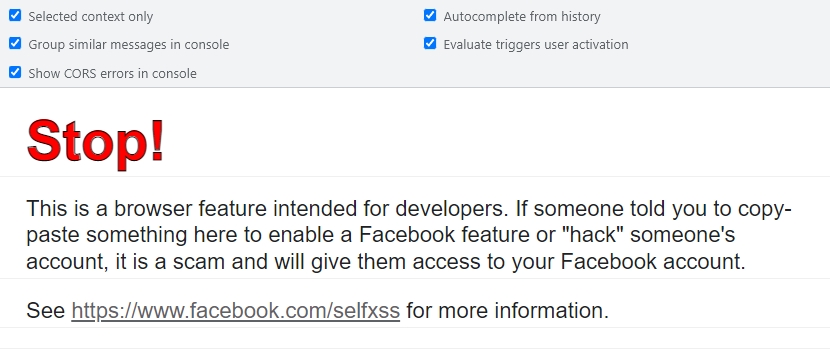
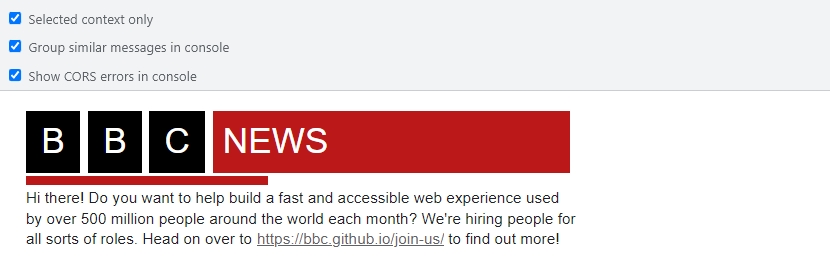

# @morev/console-css

Style browser and Node.js console messages with HTML and CSS.

[](https://github.com/MorevM/console-css/actions/workflows/build.yaml)
[](https://opensource.org/licenses/MIT)


## Why?

`¯\_(ツ)_/¯`

Sometimes you may want to warn users of your site like Facebook does:



Perhaps you want to make a prominent message to the developers like BBC does:



Maybe you want to enchance some of your custom dev utilities, etc.

**BUT**

If you want to print BBC News logotype in the console, you need to write smth like that:
```js
console.log('%cB%c %cB%c %cB%c %cNEWS       %c', 'font-style:bold;font-size:40px;padding:4px 16px;background:#000;color:#fff;', 'background:none', 'font-style:bold;font-size:40px;padding:4px 16px;background:#000;color:#fff;', 'background:none', 'font-style:bold;font-size:40px;padding:4px 16px;background:#000;color:#fff;', 'background:none', 'font-style:bold;font-size:40px;padding:4px 16px;background:#b80000;color:#fff;', 'background:none');
```

Copy-paste into you browser console and press `Enter` to see the result. \
The code doesn't look friendly, huh?

**But there is another way:**

```js
import ConsoleCSS from '@morev/console-css';

ConsoleCSS.add(`
  .letter {
    font-style: bold;
    font-size: 40px;
    padding: 4px 16px;
    background: #000000;
    color: #ffffff;
  }
  .bg-red {
    background: #ff0000;
  }
`);

ConsoleCSS.styled.log(`
  <span class="letter">B</span>
  <span class="letter">B</span>
  <span class="letter">C</span>
  <span class="letter bg-red">News</span>
`)
```
---

## Installation

### Using `yarn`

```bash
yarn add @morev/console-css
```

### Using `npm`

```bash
npm install @morev/console-css
```

### Using `pnpm`

```bash
pnpm add @morev/console-css
```

## Usage

Use the same import in a browser application and in Node.js. The package selects the renderer for the environment.
The UMD build also exposes `window.ConsoleCSS` when loaded directly with a script tag.

```js
import ConsoleCSS from '@morev/console-css';

ConsoleCSS.add('.success { color: #087672; }');
ConsoleCSS.styled.log('<b class="success">Build ready</b> · <u>%d checks passed</u>', 3);
```

### Terminal output

| Input | Browser DevTools | Node.js terminal |
| --- | --- | --- |
| `<b>`, `<i>`, `<u>`, `<s>` | Styled text | Bold, italic, underline and strikethrough, subject to terminal support |
| `color`, `background-color`, solid `background` | CSS colors | Opaque colors mapped to the terminal palette |
| `font-size`, `padding`, borders | Applied when supported by DevTools | Text at the terminal's normal size and spacing |
| `` with a source and dimensions | Image when the console permits the source | The `alt` text, or an empty string when omitted |

Tag rules, class rules and inline styles use the same precedence in both environments.
The terminal renderer also recognizes `font-weight`, `font-style`, `text-decoration` and `text-decoration-line`.
Native console substitutions and trailing objects are formatted by the destination console.

Node.js detects colors separately for stdout and stderr. Redirecting a stream to a file or pipe produces plain text by default.
Set `NO_COLOR=1` to disable styling or `FORCE_COLOR` to select a level (`0` off, `1` basic, `2` 256 colors, `3` truecolor).
An explicit `FORCE_COLOR` takes precedence.

### Default styles

By default, the package styles only well-known HTML tags:
* `<b>` - **bold** text
* `<i>` - *italic* text
* `<u>` - _underlined_ text
* `<s>` - ~~strikethrough~~ text

### Inline style

You may use inline styles:

```js
import ConsoleCSS from '@morev/console-css';

ConsoleCSS.styled.log(`<b style="color: red;">Red bold text</b>`);
```

### Adding custom CSS tokens

The core class has a method `.add(rules: string)` that accepts a CSS-like string with needed tokens. \
You can use `.add()` method multiple times.

> This input string isn't validated, so make sure your CSS syntax is correct.

```ts
import ConsoleCSS from '@morev/console-css';

ConsoleCSS.add(`
  .block { color: red; text-decoration: underline; }
`);

ConsoleCSS.styled.log('<span class="block">Red underlined text</span>');
```

### Override the global console

Use `override()` to style calls to the global `console` object in either environment.

```ts
import ConsoleCSS from '@morev/console-css';

// No matters before or after `.override()` call
ConsoleCSS.add(`
  .block { color: red; text-decoration: underline; }
`);

ConsoleCSS.override();

console.log('Wow, <span class="block">a styled message</span> using native `console.log`!');

// Restore the original console
ConsoleCSS.restore();

console.log('No longer <span class="block">styled</span> messages :(');
```

## Development

Use Node.js 24 and the pnpm version pinned in `package.json`.

```sh
pnpm install
pnpm dev
```

Open the playground at `http://localhost:3000`. Open DevTools and click **Print to both consoles**
to compare its output with the terminal running `pnpm dev`.
Run `pnpm test` to build the package and check its declarations, playground types and output in both environments.
